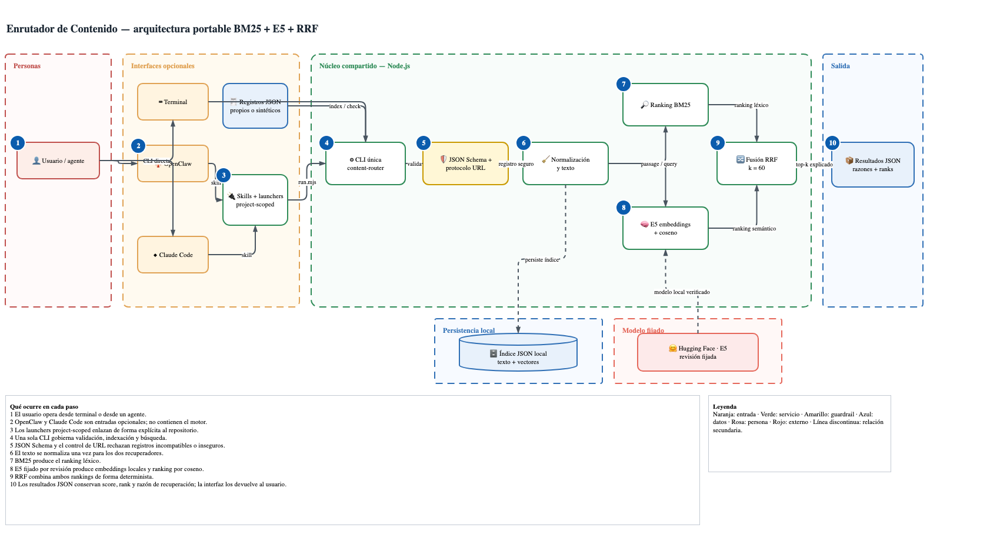

# Architecture

Open and edit the source in [diagrams.net](https://app.diagrams.net/) using
[`architecture.drawio`](architecture.drawio). Its layout specification is
available as [`architecture-spec.json`](architecture-spec.json).

The CLI is the only implementation of validation, indexing, retrieval, and
fusion. Runtime adapters contain instructions, not duplicated business logic.
That boundary lets the same repository work from a terminal, OpenClaw, Claude
Code, CI, or another tool able to execute Node.js commands.

`mock` semantic mode is deterministic and exists only for fast tests. Real use
selects the pinned `Xenova/multilingual-e5-small` revision with `--semantic=e5`.

The dashed trust boundaries separate people, optional runtime integrations,
the shared Node.js core, model acquisition, local persistence, and output.
Dashed arrows are supporting relationships; the primary request path reads
from left to right.
